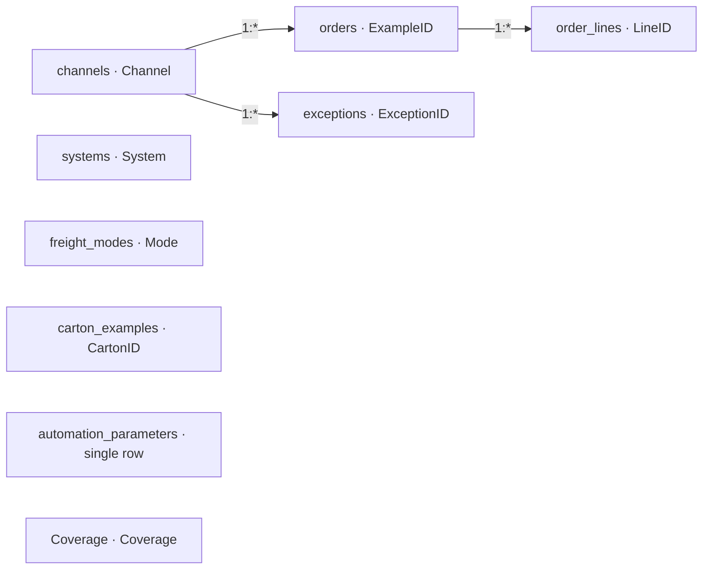

# Data model

Use Import mode and the columns and types in [data_dictionary.md](data_dictionary.md). The example model uses a shared channel dimension and a header-to-line relationship. Freight, system coverage and scenario controls have independent grains.

| One side | Many side | Filter direction |
|---|---|---|
| channels[Channel] | orders[Channel] | Single, to orders |
| channels[Channel] | exceptions[Channel] | Single, to exceptions |
| orders[ExampleID] | order_lines[ExampleID] | Single, to order_lines |

Set all three relationships active. Create the header-to-line relationship as 1:* even though the current line sample contains only one matching record. Turn off auto-detect or remove other inferred relationships. Keep the four context/configuration CSV tables and the generated Coverage table disconnected. Sort systems[Stage] by systems[StageSort]. The contextual system and mode slicers affect their respective coverage visuals only. Channel affects the verified order and exception examples only.

The supplied examples are isolated evidence. Order and line links exist only for the identified Costco PO. The correction, cancellation, cartons, dollar examples and return have no confirmed cross-links. November 2026 is the chat evidence label. May–Nov 2026 is the role period. Hide record keys and sort columns from report view after setup. Use Don't summarize for example quantities and values when they appear in detail tables. Display monetary values in the supplied dollar notation.
